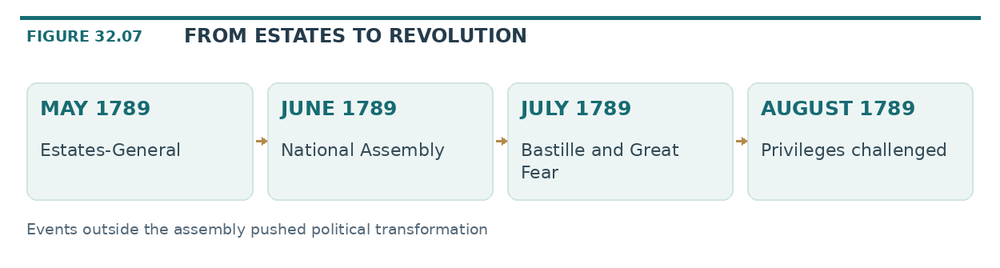

On 14 July 1789, crowds in Paris stormed the Bastille, a fortress-prison associated with royal authority. Although it held very few prisoners, its symbolic importance was enormous, and the seizure of arms mattered immediately. In the countryside, the Great Fear spread amid rumors, panic, attacks on property and seigneurial records, and resistance to feudal obligations. The revolution was becoming an event in villages as well as a contest between officials.

During the night of 4 August, the National Assembly began dismantling major elements of the old regime of privilege and seigneurial status. The legal settlement was not instant or straightforward; some dues initially required redemption, and subsequent legislation changed the terms. Nevertheless, the new political language challenged the principle that noble birth could justify separate legal entitlements. Authority was being reconstructed rather than merely transferred from a king to parliament.

<figure class="figure" id="figure-32-7">

<figcaption>Figure 32.7. Events outside the assembly pushed political transformation. <a class="figure-anchor" href="#figure-32-7" aria-label="Link to this figure">#</a></figcaption>
</figure>

Historians distinguish the <em>Great Fear</em> as a cluster of regional panics and actions, not a centrally directed national conspiracy. It is instructive that fear itself can produce consequences even when a rumor proves false. Social groups acted on beliefs about troop movements, aristocratic plots, or food supplies; those actions helped determine what the National Assembly did next.
