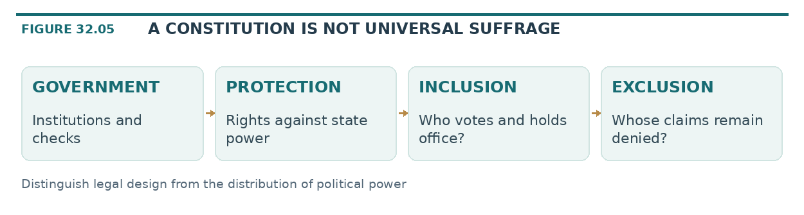

The first national framework, the Articles of Confederation, took effect in 1781 and left the central government with limited capacity to raise revenue or coordinate economic policy. Political leaders who feared that weakness convened in Philadelphia in 1787 and drafted a new Constitution. It created federal institutions, separated powers, and established mechanisms for representation and amendment. Supporters argued it would provide durable government; opponents feared that a distant central authority might threaten liberty. Ratification debates were serious political contests, not a formality.

The resulting arrangements embodied compromise and hierarchy. The Constitution provided representation in Congress and an indirect presidential election system, but did not create universal democracy. Its three-fifths formula counted enslaved people for certain representation and taxation calculations while denying them political rights; its framers made other compromises protecting slavery. The first ten amendments, ratified in 1791 and known as the Bill of Rights, helped address fears about federal power, yet they did not erase racial and gender exclusions.

<figure class="figure" id="figure-32-5">

<figcaption>Figure 32.5. Distinguish legal design from the distribution of political power. <a class="figure-anchor" href="#figure-32-5" aria-label="Link to this figure">#</a></figcaption>
</figure>

A constitution can be revolutionary without being egalitarian in every dimension. It can replace monarchy with a republic while preserving wealth-based influence, forced labor, or territorial dispossession. It is worth remembering the difference between a <em>design</em> for government and its <em>operation</em>. Over time, political struggles, court judgments, social movements, and further amendments would redefine American citizenship. Those outcomes were not already guaranteed in 1787.
