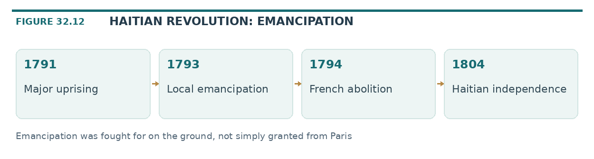

In 1793 French commissioners in Saint-Domingue proclaimed emancipation amid military crisis, insurrection, and conflict among colonial groups. In February 1794, the National Convention in Paris abolished slavery in French colonies. The relationship between events on the ground and decisions in the metropole was fundamental: the metropolitan decree endorsed a transformation for which enslaved people had already fought. It should not be portrayed as a purely generous gift from revolutionary France.

Emancipation did not settle how the export economy would operate. Plantation land, wage labor, agricultural discipline, military authority, and property rights remained contentious. Formerly enslaved workers often wanted greater control over their own time, families, and land, while revolutionary commanders and officials feared a collapse of production and military supplies. The legal destruction of slavery opened new conflicts about the substance of freedom.

<figure class="figure" id="figure-32-12">

<figcaption>Figure 32.12. Emancipation was fought for on the ground, not simply granted from Paris. <a class="figure-anchor" href="#figure-32-12" aria-label="Link to this figure">#</a></figcaption>
</figure>

A comparative point now becomes visible. In the United States, revolutionary leaders could declare independence while retaining slavery. In France, a revolution proclaimed rights and, for a time, abolished slavery across its colonial empire. In Saint-Domingue, freedom was created and defended by organized struggle within a plantation colony. These differences warn against presenting the Atlantic Revolutions as one uniform march toward liberty.
