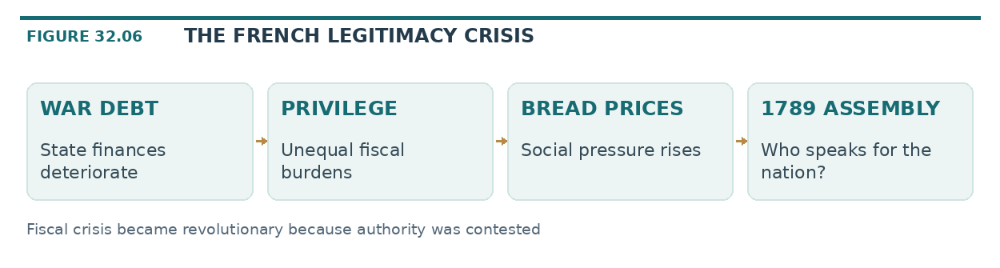

In France, the monarchy presided over a society conventionally described through three estates: clergy, nobility, and the Third Estate, which encompassed everyone else. This formal division did not capture every inequality. Some commoners were wealthy; some nobles had modest resources; local privileges and regional courts complicated royal reform. Still, exemptions and unequal fiscal obligations made the system contentious, especially when state finances deteriorated after expensive wars and borrowing.

France's fiscal crisis had several causes, including debt service, an inefficient and inequitable revenue structure, political resistance to reform, and the costs of helping the American rebellion. Poor harvests in 1788 and high bread prices heightened distress. The monarchy did not face a simple technical shortage of money; it faced a political problem in obtaining agreement about who should pay and which institution had the authority to decide. Fiscal administration became a question of sovereignty.

<figure class="figure" id="figure-32-6">

<figcaption>Figure 32.6. Fiscal crisis became revolutionary because authority was contested. <a class="figure-anchor" href="#figure-32-6" aria-label="Link to this figure">#</a></figcaption>
</figure>

Louis XVI summoned the Estates-General for 1789, the first such national assembly since 1614. Preparations included the <em>cahiers de doléances</em>, lists of grievances that recorded a wide spectrum of expectations. Some writers wanted reform while preserving monarchy; others criticized privilege more profoundly. The crisis made political participation visible at a scale that ordinary royal administration had not anticipated.
