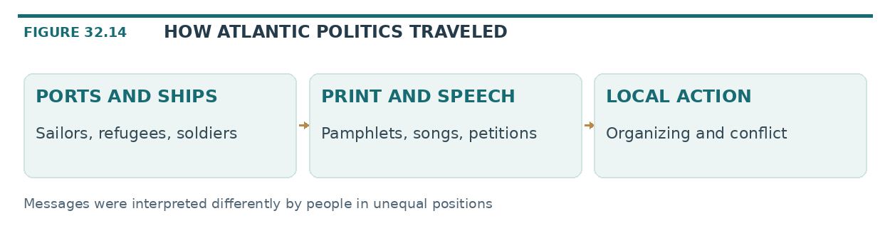

Ideas moved through letters, sailors, military volunteers, diplomatic missions, books, port newspapers, exiles, and returning soldiers. Some claims were translated or adapted for new audiences. Others were distorted by fear or selective reporting. A newspaper in a slaveholding port might portray events in Haiti as dangerous disorder, while an enslaved reader or listener could understand them as proof that bondage might be challenged. The same event acquired radically different meanings depending on who controlled its retelling.

Communications were slower, more uneven, and more fragile than modern media networks. News could arrive after circumstances had changed. Political pamphlets circulated within literacy and cost constraints, while speeches, songs, religious gatherings, and oral networks reached audiences that printed texts did not. Claims that one famous book 'caused' a revolution usually exaggerate the power of individual authors and overlook the organizational work that turned ideas into action.

<figure class="figure" id="figure-32-14">

<figcaption>Figure 32.14. Messages were interpreted differently by people in unequal positions. <a class="figure-anchor" href="#figure-32-14" aria-label="Link to this figure">#</a></figcaption>
</figure>

It is helpful to think of a chain: <em>grievance → organized networks → public arguments → confrontation → changing institutions</em>. But the chain loops. Confrontation produces new grievances; laws create new categories of participants; war changes alliances; foreign powers intervene. The process is not a predetermined sequence. This is why revolutions are better explained through interacting conditions than through a single heroic decision.
