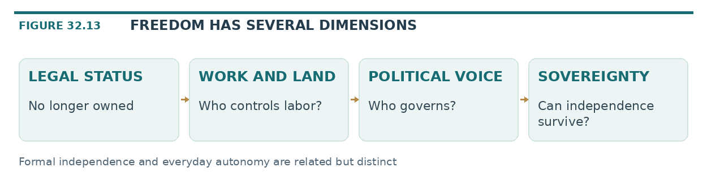

Napoleon Bonaparte sent a major expedition to Saint-Domingue in 1802 to reassert metropolitan control. In the same period, his government restored slavery in French colonies where it had not effectively been abolished or where French control was reestablished. Fears that slavery might return to Saint-Domingue were therefore grounded in contemporary policy and events, not merely rumor. Louverture was captured and transported to France, where he died in 1803.

The conflict continued under other commanders, including Jean-Jacques Dessalines and Henri Christophe. French forces suffered from fierce resistance, strategic difficulties, and devastating disease. Their defeat at the Battle of Vertières in November 1803 was followed by a declaration of independence on 1 January 1804. The new state took the name Haiti, recalling Indigenous history while breaking with the French colonial regime.

<figure class="figure" id="figure-32-13">

<figcaption>Figure 32.13. Formal independence and everyday autonomy are related but distinct. <a class="figure-anchor" href="#figure-32-13" aria-label="Link to this figure">#</a></figcaption>
</figure>

Independence did not end coercion or political violence. Dessalines's forces carried out killings of many remaining French whites in 1804; the new state also confronted destruction, diplomatic isolation, internal rivalries, and conflict over labor and land. Haiti's revolutionary achievement—the successful creation of an independent state through a revolt against slavery—must be taught alongside these difficulties. Celebrating emancipation does not require erasing atrocities, and recognizing atrocities does not diminish emancipation.
