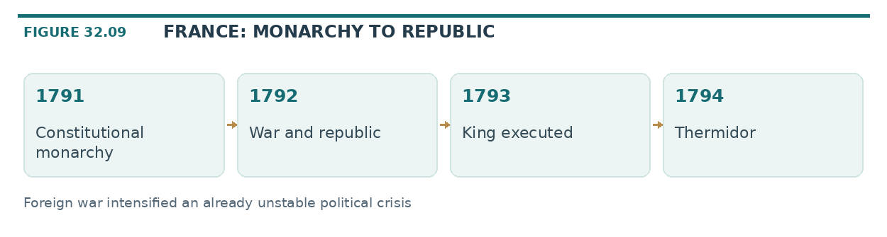

The National Convention declared a republic in September 1792. Louis XVI was executed in January 1793 after a political trial and legislative vote. These events shocked European monarchies and transformed the conflict from a struggle over constitutional monarchy into a contest involving dynastic legitimacy and revolutionary sovereignty. Revolutionary France faced foreign armies, internal uprisings, financial difficulties, and deep disagreement over the correct pace and form of change.

Factional labels such as Girondins and Montagnards can be useful, but they describe shifting coalitions, not modern disciplined political parties. Urban activists known as sans-culottes pressed demands concerning bread, prices, and political participation. Rural communities differed in their response to conscription, religious reforms, taxation, and revolutionary authority. The war in the Vendée became especially destructive, involving rebellion, brutal suppression, and violence against civilians.

<figure class="figure" id="figure-32-9">

<figcaption>Figure 32.9. Foreign war intensified an already unstable political crisis. <a class="figure-anchor" href="#figure-32-9" aria-label="Link to this figure">#</a></figcaption>
</figure>

It is important not to flatten participants into 'the people' on one side and 'enemies of freedom' on the other. A Parisian worker, a provincial priest, a peasant household, and a revolutionary soldier might hold different views about religion, food prices, war, and democracy. Political legitimacy under crisis depends on whose voice authorities recognize and which forms of dissent they allow.
