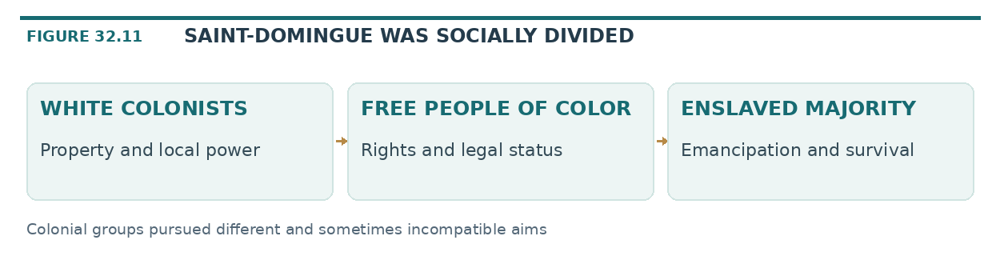

Colonial plantation society made legal distinctions among enslaved persons, free people of color, and whites, while wealth, status, place of birth, and political alliances complicated those categories. French colonial law, including the <em>Code Noir</em> tradition, regulated aspects of enslavement but did not make it humane. Plantation discipline, forced work, sexual violence, high mortality, and the constant arrival of enslaved Africans were conditions of the export economy, not accidental abuses by a handful of individuals.

Even under coercion, enslaved people created collective life. Families, religious gatherings, language practices, music, market exchanges, and informal networks enabled survival and sometimes organized resistance. Marronage—escape from slavery, sometimes into independent communities—was one form of resistance; sabotage, negotiation, flight, and the preservation of cultural autonomy took others. A history written solely through proclamations from Paris misses the institutional knowledge and initiative required for revolt.

<figure class="figure" id="figure-32-11">

<figcaption>Figure 32.11. Colonial groups pursued different and sometimes incompatible aims. <a class="figure-anchor" href="#figure-32-11" aria-label="Link to this figure">#</a></figcaption>
</figure>

The French Revolution posed an explosive question. If rights belong to human beings, by what principle could an empire classify some human beings as property? Planter representatives tried to protect slavery and commercial privileges. Free people of color demanded rights that whites commonly denied them. Enslaved people could press a more radical demand than either side initially accepted: the destruction of slavery itself.
