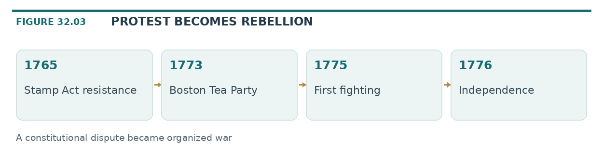

After 1763, Parliament pursued new imperial revenue and regulatory measures. The Stamp Act of 1765 imposed duties on printed materials, provoking protests, petitions, and organized resistance. Colonists argued over taxation without representation in Parliament, while British officials emphasized Parliament's claimed sovereignty over the empire. Repeal of one measure did not settle the underlying constitutional dispute. Later Townshend duties and the Tea Act of 1773 renewed contention about who could legitimately tax whom.

Opponents of imperial measures organized boycotts, committees of correspondence, public demonstrations, and sometimes intimidation. The Boston Tea Party of December 1773 dramatized resistance to the Tea Act and the East India Company's privileges. Britain's punitive response in 1774 closed Boston's port and altered Massachusetts government, among other measures; Patriot leaders described these laws as intolerable. Political communication, commercial pressure, and local mobilization made conflict increasingly difficult to contain.

<figure class="figure" id="figure-32-3">

<figcaption>Figure 32.3. A constitutional dispute became organized war. <a class="figure-anchor" href="#figure-32-3" aria-label="Link to this figure">#</a></figcaption>
</figure>

The argument was not simply that taxes were high. Some disputed taxes were relatively small compared with the constitutional principle at stake. Nor were merchants and consumers always united: boycotts imposed economic sacrifices unevenly. Notice how <em>constitutional meaning</em> and <em>material interests</em> reinforced one another. Colonists interpreted revenue measures as a threat to inherited political rights; British authorities interpreted organized defiance as a threat to the empire's capacity to govern.
