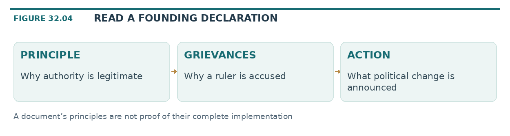

On 4 July 1776, the Continental Congress adopted the Declaration of Independence. Its argument combined a claim about the right of a people to separate from an oppressive government with a list of grievances against George III. It presented legitimate power as dependent on the consent of the governed and described rights that could not simply be surrendered to rulers. These ideas were influential, but did not begin with the document itself: older constitutional, religious, and Enlightenment arguments had prepared the ground.

Read its most famous propositions carefully. When it proclaimed human equality, did it create equal civil status for enslaved people, women, or Indigenous nations? No. The Declaration was an assertion of independence and political principle; it was not an immediate abolition statute or a universal voting law. Many signers benefited from slavery or accepted territorial expansion that harmed Native peoples. The contradiction does not make the language historically insignificant; it makes the difference between promises and institutions central to understanding the new republic.

<figure class="figure" id="figure-32-4">

<figcaption>Figure 32.4. A document’s principles are not proof of their complete implementation. <a class="figure-anchor" href="#figure-32-4" aria-label="Link to this figure">#</a></figcaption>
</figure>

A primary-source exercise: separate three layers in the Declaration. One is <em>political philosophy</em>: why a government is legitimate. A second is <em>indictment</em>: accusations about the king's behavior, some selectively framed. A third is <em>political action</em>: the colonies proclaiming themselves states. Evidence that a declaration was adopted establishes the third layer; evaluating the second requires broader context; judging how fully the first was implemented requires later law and social history.
