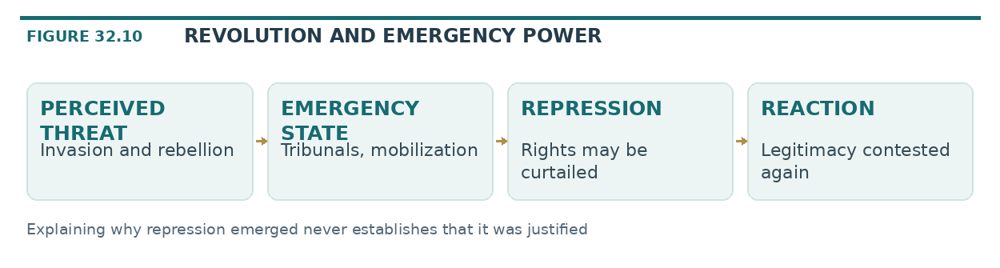

Revolutionary laws and experiences outlasted changes of regime. The end of corporate privilege, new administrative forms, debates about secular authority, legal equality for men in many contexts, and the idea that citizens could be mobilized for national war proved durable or influential. Napoleonic rule consolidated some changes while reversing or restricting others and building an authoritarian empire. A useful question is not simply whether the revolution succeeded, but which particular transformations persisted and for whom.

French armies and administrators carried revolutionary and Napoleonic institutions into other parts of Europe, often through coercion. Occupied populations did not receive these transformations as neutral gifts. Some welcomed reforms to property, law, or privilege; others resisted requisitions, taxes, conscription, and foreign control. The resulting conflicts helped shape later national and constitutional movements. European developments will reappear in Chapters 34–37.

<figure class="figure" id="figure-32-10">

<figcaption>Figure 32.10. Explaining why repression emerged never establishes that it was justified. <a class="figure-anchor" href="#figure-32-10" aria-label="Link to this figure">#</a></figcaption>
</figure>

The French revolution also exposed a recurring tension: movements that claim popular sovereignty require institutions to make disagreement bearable. Without protected opposition, predictable procedures, and constraints on emergency power, a government can invoke the people as justification for suppressing actual people. This lesson is not unique to France, but France offers a particularly concentrated historical example.
