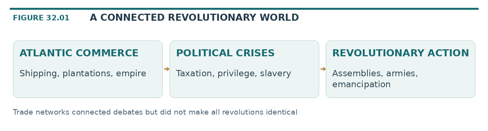

The Atlantic Ocean did not become an integrated political world overnight. As earlier chapters showed, centuries of empire, commercial shipping, plantation production, coerced migration, and warfare connected its shores. By the eighteenth century, news, books, soldiers, merchant credit, refugees, and political arguments could circulate between North America, the Caribbean, western Europe, and parts of Africa. A conflict over taxation in one port might affect shipping costs elsewhere; an uprising on a sugar estate could influence the fears of slaveholders thousands of kilometres away.

Historians use the phrase <em>Atlantic Revolutions</em> to identify linked political transformations from roughly the late eighteenth to the early nineteenth century. The category is useful, but should not erase the distinct histories of Indigenous societies, West Africa, or Latin America. Nor did ideas travel in only one direction, from European philosophers to passive colonial audiences. People living under empire, and especially those fighting enslavement, changed the content and consequences of political language themselves.

<figure class="figure" id="figure-32-1">

<figcaption>Figure 32.1. Trade networks connected debates but did not make all revolutions identical. <a class="figure-anchor" href="#figure-32-1" aria-label="Link to this figure">#</a></figcaption>
</figure>

A comparative approach asks four questions of each movement. First, what old arrangement was being challenged? Second, which groups had the resources to mobilize? Third, how did war and international politics alter the struggle? Fourth, who gained meaningful rights after victory? These questions prevent the most common mistake: assuming that a revolution's declaration perfectly describes its society. A document is evidence of a claim and an aspiration; the practical distribution of power must be investigated separately.
