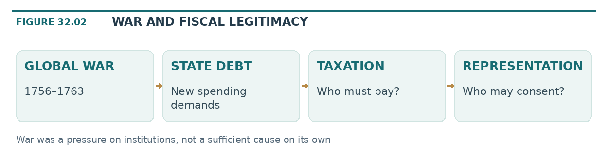

The Seven Years' War (1756–1763) was fought across Europe, North America, the Caribbean, and Asian theatres. In North America it overlapped with the conflict conventionally called the French and Indian War. Britain's victories expanded its territorial claims but came with large debts and new administrative responsibilities. France also faced difficult finances, and its later intervention in the American struggle placed further pressure on royal revenues. Large-scale war thus linked imperial success to fiscal vulnerability.

This is an example of a wider historical mechanism. A state borrows and taxes to finance war. New revenue demands anger groups who question the fairness of the burden and whether their consent matters. Political authorities try to assert greater control; organized resistance can disrupt collection and challenge legitimacy. Neither debt nor taxation automatically causes revolution: many governments survive heavy debts. The decisive issue is how financial pressures interact with institutions, social expectations, and opportunities for collective action.

<figure class="figure" id="figure-32-2">

<figcaption>Figure 32.2. War was a pressure on institutions, not a sufficient cause on its own. <a class="figure-anchor" href="#figure-32-2" aria-label="Link to this figure">#</a></figcaption>
</figure>

For Britain and its colonies, the end of the war also raised western territorial disputes. The Royal Proclamation of 1763 attempted to regulate settlement west of the Appalachian Mountains, but colonists, land speculators, and Indigenous nations had conflicting interests. Indigenous peoples were not simply observers of an Anglo-American argument. Their sovereignty and territorial survival were central to the expanding empire, even though the revolutionary rhetoric of later years often ignored them.
