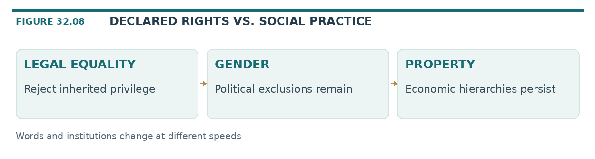

In October 1789, thousands of women and other demonstrators marched from Paris toward Versailles, protesting bread shortages and political conditions. The royal family was brought to Paris, placing the monarchy under closer public pressure. The march illustrates that material needs and political action cannot be separated. Demanding bread was not evidence of ignorance about politics; it was an insistence that a legitimate regime must meet the needs of people whose labor sustained it.

Women also organized clubs, wrote petitions, debated sovereignty, and participated in political demonstrations. In 1791, Olympe de Gouges published a <em>Declaration of the Rights of Woman and of the Female Citizen</em>, modeled on the 1789 rights declaration and directed against women's exclusion. Her intervention was not the only feminist voice of the period, but it provides an unusually clear primary text for comparing universal claims with gendered citizenship.

<figure class="figure" id="figure-32-8">

<figcaption>Figure 32.8. Words and institutions change at different speeds. <a class="figure-anchor" href="#figure-32-8" aria-label="Link to this figure">#</a></figcaption>
</figure>

Revolutionaries disagreed about how to recognize women as political actors, and women's political clubs were later suppressed. Reducing the period to an uncomplicated expansion of rights conceals this reversal. For a study exercise, compare the formal legal boundaries of citizenship with the forms of influence available through protest, publication, charity, and household networks. People could be politically active without enjoying full formal rights.
