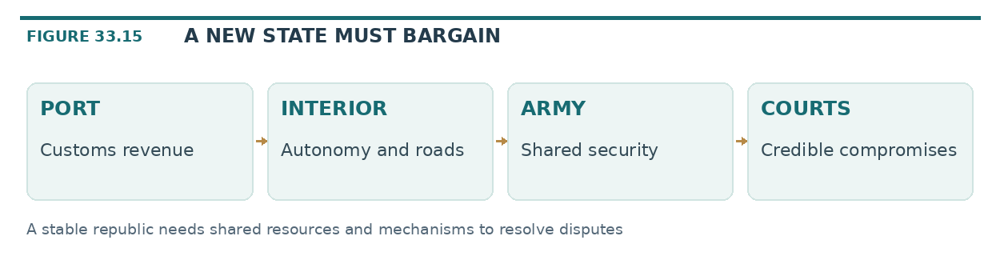

Consider a fictional republic of three provinces after a long independence war. A coastal capital controls the main customs house and collects 70 units of revenue. Two interior provinces together collect 30. National defense and courts require 80 units, while the provinces each want roads, schools, and autonomy over local militias. The coastal capital proposes sending 60 units into a central treasury. An interior governor fears that appointments and contracts will favor the port, while a second governor argues that no province can survive a foreign attack alone.

All parties have intelligible concerns. Centralization might improve defense and credit, but could concentrate patronage. Decentralization might protect local decision-making, but could leave a common government unable to enforce shared decisions. The port's merchants benefit from national stability but may resist higher duties that reduce trade. Rural landholders want roads but resist direct taxation. A general with unpaid soldiers may intervene regardless of what the constitution says.

<figure class="figure" id="figure-33-15">

<figcaption>Figure 33.15. A stable republic needs shared resources and mechanisms to resolve disputes. <a class="figure-anchor" href="#figure-33-15" aria-label="Link to this figure">#</a></figcaption>
</figure>

The numbers are <strong>constructed teaching assumptions</strong>, not data from a real Latin American republic. Their purpose is to turn abstract phrases—federalism, caudillismo, fiscal weakness—into decisions with trade-offs. A durable state requires rules for revenue sharing, credible dispute resolution, civilian control of armed forces, and political willingness to lose a vote without abandoning the union.
