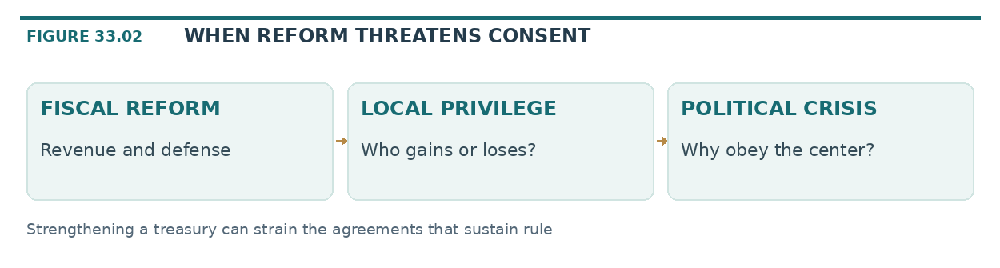

After costly wars and strategic defeats, Spain tried to make its American possessions more productive and defensible. The eighteenth-century Bourbon reforms reorganized territories, enlarged some administrative capacities, tightened revenue collection, and encouraged selected trade changes. New or revised taxes affected commerce and consumption; military and bureaucratic initiatives depended on colonial resources. Reform was not uniform. Some ports gained commercial opportunities, while particular producers, officials, and corporations feared lost privileges or growing scrutiny.

The response was equally uneven. Colonial economies were neither uniformly stagnant nor uniformly prosperous. Silver mining in Mexico and Peru, agricultural trade, craft industries, and Atlantic commerce created wealth, but colonial fiscal demands distributed burdens unequally. Across the empire, local people evaluated reform through lived questions: Would a tax collector demand more? Would a rival merchant receive access to a market? Would an Indigenous community lose an old protection? Would a militia officer gain status?

<figure class="figure" id="figure-33-2">

<figcaption>Figure 33.2. Strengthening a treasury can strain the agreements that sustain rule. <a class="figure-anchor" href="#figure-33-2" aria-label="Link to this figure">#</a></figcaption>
</figure>

A useful causal lesson emerges. <strong>A reform can strengthen an empire's resources while weakening the political agreements that make that empire governable.</strong> Fiscal grievances alone did not cause independence. They became explosive when combined with contested sovereignty, war, existing inequalities, and opportunities for regional groups to organize themselves.
