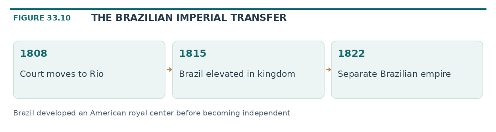

Brazil followed an unusually distinctive path. Facing Napoleon's invasion of Portugal, the Portuguese court transferred to Rio de Janeiro in 1808, making a major American city the temporary seat of a European monarchy. Royal institutions, administrators, and new commercial arrangements moved or developed in Brazil. In 1815 Brazil's formal status was elevated within the United Kingdom of Portugal, Brazil and the Algarves. This experience altered relations between the Portuguese imperial center and its American territories.

When a constitutional revolution in Portugal in 1820 challenged the old order, conflicting demands emerged about whether Brazil should again be governed primarily from Lisbon. Prince Pedro remained in Brazil and proclaimed independence in 1822; he became Emperor Pedro I. Independence was neither universally peaceful nor uncontested. Armed conflicts continued in several provinces, including Bahia, and local elites disagreed about the new monarchy's powers.

<figure class="figure" id="figure-33-10">

<figcaption>Figure 33.10. Brazil developed an American royal center before becoming independent. <a class="figure-anchor" href="#figure-33-10" aria-label="Link to this figure">#</a></figcaption>
</figure>

Brazil therefore illustrates that independence did not necessarily require the immediate abolition of monarchy. A court that had already relocated across the Atlantic offered a basis for a new imperial center in Rio, while constitutional debates and resistance shaped the resulting state. The continuities mattered as much as the formal break with Portugal.
