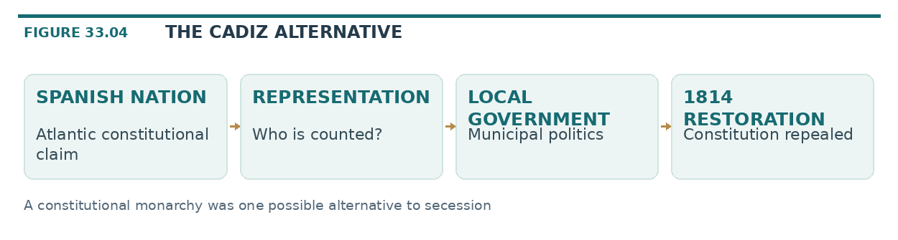

While war against Napoleon continued in Spain, representatives convened in Cádiz and produced the Constitution of 1812. It presented a constitutional monarchy and a Spanish nation embracing both sides of the Atlantic, while structuring representation, political rights, and local government in contested ways. It was not simply a European document imposed on passive Americans. Delegates and arguments from American territories were part of the constitutional debate, though distance and electoral arrangements limited representation.

The Cádiz settlement introduced a possible alternative to outright separation: a reformed transatlantic monarchy with constitutional institutions. Its assumptions about citizenship and social categories were both innovative and exclusionary. The issue of how to count or include people of African descent, for example, became especially controversial. Municipal elections and constitutional language offered some local communities new political strategies while also threatening older jurisdictional arrangements.

<figure class="figure" id="figure-33-4">

<figcaption>Figure 33.4. A constitutional monarchy was one possible alternative to secession. <a class="figure-anchor" href="#figure-33-4" aria-label="Link to this figure">#</a></figcaption>
</figure>

Restoration of Ferdinand VII in 1814 brought the repeal of the constitution and a renewed absolutist attempt to regain control, while the liberal revolution in Spain in 1820 restored constitutional rule again. These reversals affected political calculation in Mexico and elsewhere. The constitutional crisis of the empire was not a short prelude to independence; it remained part of independence itself.
