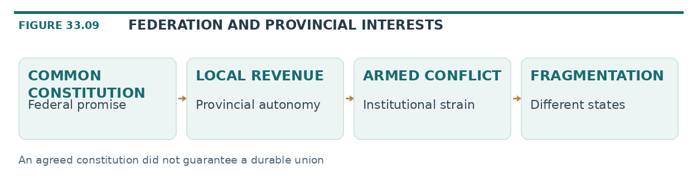

The provinces of the former Kingdom of Guatemala declared independence from Spain in 1821, then experienced a short association with the Mexican Empire before a separate Central American political project emerged. A federation was established in 1823–1824, linking territories corresponding to present-day Guatemala, El Salvador, Honduras, Nicaragua, and Costa Rica. Its leaders faced arguments about federalism, provincial autonomy, religion, taxation, and control over military forces.

The federation possessed a constitution and the language of common citizenship, yet its member states differed in economy, local power networks, and ideas about who should govern. Poor transport and uncertain revenues made common institutions expensive. Conflict between liberal and conservative political coalitions became intertwined with regional rivalries and armed struggles. By the late 1830s and early 1840s the federation had broken apart.

<figure class="figure" id="figure-33-9">

<figcaption>Figure 33.9. An agreed constitution did not guarantee a durable union. <a class="figure-anchor" href="#figure-33-9" aria-label="Link to this figure">#</a></figcaption>
</figure>

It would be inaccurate to call this history simply a failed imitation of the United States. Central Americans debated legitimate authority within their own colonial legacies, landholding systems, and fiscal constraints. Their federation was a genuine political option, not a minor detour before five modern states inevitably emerged. It shows how independence could create new possibilities while making the location of final sovereignty fiercely contested.
