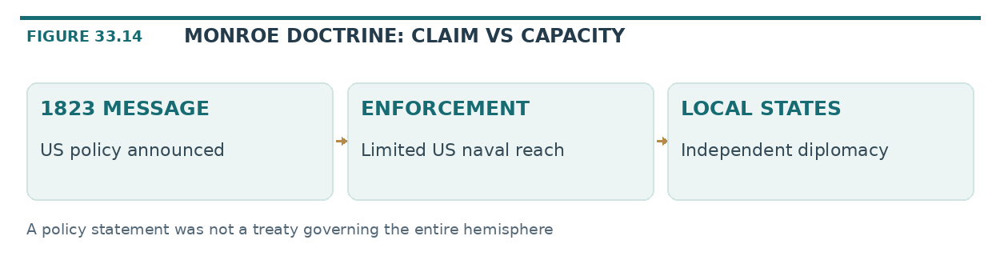

New states also needed diplomatic recognition and access to international trade. Britain often pursued commercial opportunities and sought to limit rival European influence without necessarily intending direct territorial conquest. Recognition was political and could be slow or conditional. Spain did not immediately accept every former colony's independence, and constitutional and diplomatic conditions in Europe continued to matter.

In the United States, President James Monroe's 1823 message to Congress announced a policy opposing further European colonization and certain forms of intervention in the Americas. It has come to be called the <em>Monroe Doctrine</em>. At the time, the United States had limited power to enforce it across the hemisphere, and British maritime strength helped deter some European ventures. The doctrine was a United States policy claim, not a treaty signed by the new Latin American countries.

<figure class="figure" id="figure-33-14">

<figcaption>Figure 33.14. A policy statement was not a treaty governing the entire hemisphere. <a class="figure-anchor" href="#figure-33-14" aria-label="Link to this figure">#</a></figcaption>
</figure>

The distinction prevents anachronism. The later United States became far more influential, but its power in 1823 must not be imagined as identical to its power a century later. Latin American diplomats and political leaders pursued their own objectives, worried about European restoration, and sometimes distrusted the ambitions of neighboring states. The international system shaped independence without determining every domestic choice.
