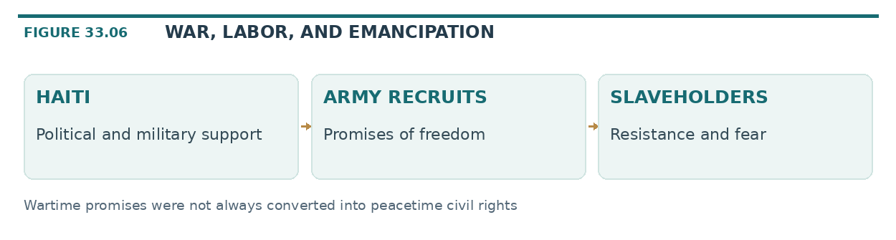

Haiti, independent since 1804, played an important role in the wider Atlantic politics of freedom. In 1815–1816 Bolívar received support in Haiti, including from President Alexandre Pétion, and the issue of emancipation became entangled with military assistance and political legitimacy. The details of their exchanges must be approached through surviving correspondence and later accounts rather than heroic anecdotes. Yet the broader point is clear: the Haitian revolution influenced mainland debates about slavery and sovereignty.

The promise of freedom also confronted powerful economic interests. Enslaved labor remained important in places such as coastal Venezuela, Colombia, Cuba, and Brazil, though its scale and forms varied. Free people of African descent had occupations, communities, and political ambitions that did not depend on a single revolutionary leader. Some slaveholders embraced independence while resisting emancipation; others accepted gradual legal change under pressure of war and political negotiation.

<figure class="figure" id="figure-33-6">

<figcaption>Figure 33.6. Wartime promises were not always converted into peacetime civil rights. <a class="figure-anchor" href="#figure-33-6" aria-label="Link to this figure">#</a></figcaption>
</figure>

Haiti's example also provoked fear among slaveholding elites. The same revolution could be celebrated as proof of anticolonial freedom and condemned as a threat to property and racial hierarchy. These contradictory reactions are essential to understanding why the law of slavery changed unevenly across nineteenth-century Latin America, and why the independence of a country should never be mistaken for the liberation of all its inhabitants.
