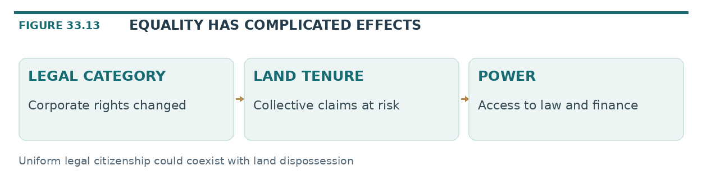

Independence made it possible to challenge colonial legal distinctions, but the practical consequences for Indigenous peoples were contradictory. Some constitutions promised equality among citizens. Yet reforms could also eliminate collective legal categories or communal protections without giving communities secure land rights or meaningful political influence. Legislators sometimes imagined a uniform national citizen and treated Indigenous languages and institutions as obstacles to modernization.

Other actors fought to preserve village lands, local autonomy, and recognized customary arrangements. Communities could petition courts, negotiate military alliances, resist taxation, or join regional rebellions. Their position depended on local patterns of property, the strength of collective institutions, and relations with provincial governments. Indigenous people did not merely react; they shaped the possibilities and limits of state formation.

<figure class="figure" id="figure-33-13">

<figcaption>Figure 33.13. Uniform legal citizenship could coexist with land dispossession. <a class="figure-anchor" href="#figure-33-13" aria-label="Link to this figure">#</a></figcaption>
</figure>

An important analytical distinction is <strong>formal equality versus effective protection</strong>. Removing a law that marks a community as legally separate may expand one right while exposing its land to powerful private purchasers. Conversely, preserving a collective institution may defend resources while also maintaining some unequal treatment. There is no simple equation in which every policy labeled liberal automatically produces greater freedom for everyone.
