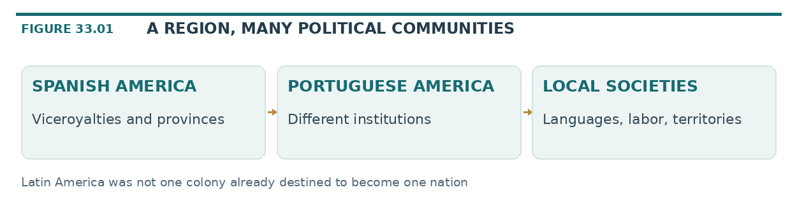

The label <em>Latin America</em> is useful for discussing parts of the Americas shaped deeply by Spanish, Portuguese, and French languages and institutions. It is a retrospective regional term, however, not an identity uniformly shared by early nineteenth-century inhabitants. The Spanish monarchy ruled extensive but differently organized jurisdictions: New Spain, New Granada, Peru, and Río de la Plata; captaincies-general and provincial governments; royal courts called <em>audiencias</em>; municipalities; and church institutions. Portuguese America developed a different administrative and commercial history. The Caribbean included places whose political futures diverged dramatically from those of the mainland.

Geography amplified variation. The highland settlements of central Mexico and the Andes were not governed and supplied in the same way as cattle-raising plains, Amazonian frontiers, Pacific ports, or Caribbean plantations. Mountains could separate armies and provinces; rivers and maritime routes could unite commercial interests across political borders. Populations differed by region in their histories of Indigenous autonomy, African enslavement, European migration, mixed ancestry, landownership, and occupation. A slogan proclaimed in one capital might mean little to a village facing demands for soldiers and grain.

<figure class="figure" id="figure-33-1">

<figcaption>Figure 33.1. Latin America was not one colony already destined to become one nation. <a class="figure-anchor" href="#figure-33-1" aria-label="Link to this figure">#</a></figcaption>
</figure>

Therefore <em>the wars of independence</em> refers to overlapping struggles, not one coordinated Latin American campaign. Historians compare regions to identify common mechanisms—imperial crisis, competition over sovereignty, fiscal pressure, mobilization—but they must also trace local alliances and disagreements. A wealthy landholder, a free Black artisan, a rural Indigenous leader, and an enslaved laborer could all use the language of freedom while seeking quite different outcomes.
