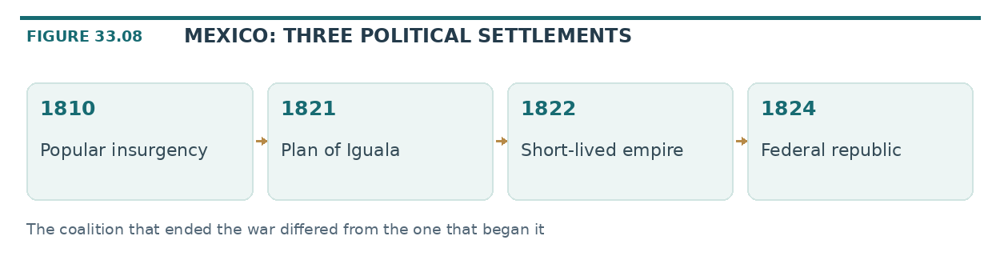

The final break with Spain took shape amid the renewed constitutional crisis of the monarchy after 1820. Conservative property holders and religious actors who had opposed earlier insurgents now had reasons to resist a liberal constitutional order overseas. Agustín de Iturbide, previously an officer fighting for the Crown, negotiated with insurgent Vicente Guerrero. The Plan of Iguala in 1821 promoted independence, Catholic religion, and unity under a monarchical formula, though the meaning of its promises differed among supporters.

The Army of the Three Guarantees advanced the settlement, and Mexico became independent in 1821. Iturbide was crowned emperor in 1822, but the empire soon faced opposition and collapsed in 1823. The federal constitution of 1824 inaugurated a republican framework. This rapid shift from monarchy to republic makes a useful comparison with Brazil, whose imperial monarchy lasted much longer.

<figure class="figure" id="figure-33-8">

<figcaption>Figure 33.8. The coalition that ended the war differed from the one that began it. <a class="figure-anchor" href="#figure-33-8" aria-label="Link to this figure">#</a></figcaption>
</figure>

The Mexican case demonstrates an important distinction between <em>the insurgency that begins a revolution</em> and <em>the coalition that completes a transfer of sovereignty</em>. Different groups may join an independence movement at different moments, seeking different institutions. Looking only at the final agreement conceals the social conflicts that made it possible; looking only at the first uprising conceals why the final settlement took an unexpected shape.
