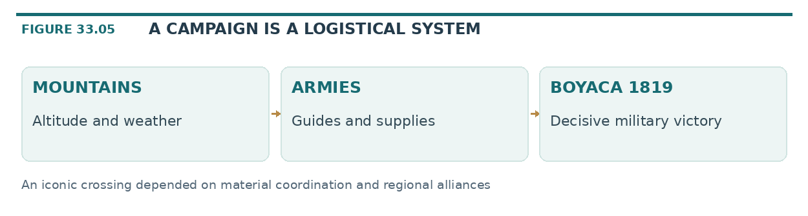

In 1819 Bolívar led a campaign across difficult Andean terrain into New Granada. The patriot victory at Boyacá in August was decisive for control of Bogotá and strengthened the project of uniting Venezuela and New Granada. Logistics matter here. Soldiers and animals faced altitude, cold, muddy passes, disease, and supply shortages. Accounts celebrating a brilliant commander are incomplete unless they also recognize local guides, transport workers, recruited fighters, and the political organization needed to sustain the force.

The new Republic of Colombia, usually called <em>Gran Colombia</em> by later historians to distinguish it from the modern country, brought together territories broadly associated with present-day Colombia, Venezuela, Ecuador, and Panama. The Constitution of Cúcuta in 1821 sought to organize a central government and define citizens' rights and offices. The republic existed as a contested political project, not as a culturally homogeneous nation waiting to be united.

<figure class="figure" id="figure-33-5">

<figcaption>Figure 33.5. An iconic crossing depended on material coordination and regional alliances. <a class="figure-anchor" href="#figure-33-5" aria-label="Link to this figure">#</a></figcaption>
</figure>

The military campaigns continued as control shifted across the region. At Carabobo in 1821, patriot forces secured a major victory in Venezuela. In the territory of present-day Ecuador, Antonio José de Sucre's victory at Pichincha in 1822 was decisive for Quito. These struggles depended on multinational armies and complex local alliances, and later patriotic commemorations can obscure their improvisational character.
