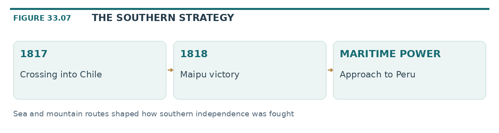

José de San Martín, an experienced officer who had served in Spain, became central to campaigns in the southern half of South America. Rather than relying solely on an overland thrust from the Río de la Plata toward royalist strongholds in Upper Peru, he helped organize an army in the Cuyo region and cross the Andes into Chile in 1817. This strategic choice involved training, mountain logistics, intelligence, and coordination with Chilean patriots including Bernardo O'Higgins.

The victory at Chacabuco in 1817 strengthened the patriot position; the Battle of Maipú in 1818 consolidated Chilean independence after renewed military danger. The crossing itself deserves analysis beyond its fame: high mountains limit routes, pack animals carry finite supplies, and weather can disrupt communications. Military success came from planning and social mobilization as much as individual courage.

<figure class="figure" id="figure-33-7">

<figcaption>Figure 33.7. Sea and mountain routes shaped how southern independence was fought. <a class="figure-anchor" href="#figure-33-7" aria-label="Link to this figure">#</a></figcaption>
</figure>

San Martín then supported a maritime campaign toward Peru, where the viceroyal administration remained a major royalist center. A fleet, shipping contracts, coastal bases, and political promises mattered as much as battlefield victories. The southern campaign demonstrates why no account of independence limited to land battles can explain how power changed hands along the Pacific coast.
