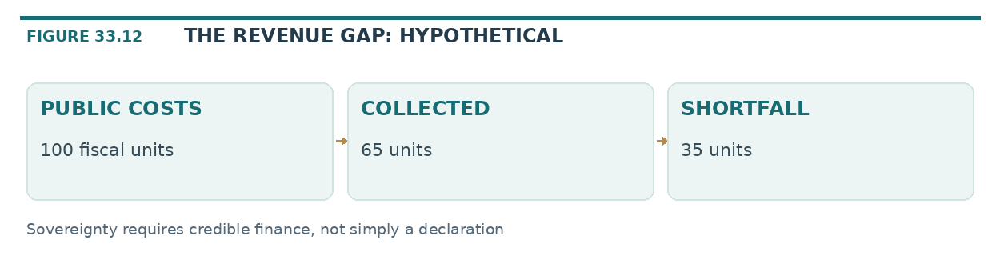

An imperial system could move revenue among territories to finance administration, armies, and defense. Independence disrupted this arrangement. Mining districts suffered wartime damage, fields and roads were devastated, trade declined in some areas, and colonial fiscal mechanisms lost legitimacy or capacity. New governments nevertheless needed money to pay officials, defend borders, establish courts, and honor debts. Citizens might embrace independence while resisting taxes associated with the old regime.

Customs duties became particularly attractive because they could be collected at ports where goods physically passed through. But customs revenues were unevenly distributed. A port city could become politically powerful while inland provinces regarded the treasury as unfairly concentrated. Governments borrowed at home and abroad, sometimes under terms that later constrained choices. Borrowing could help sustain the state in a crisis, but debt service reduced resources available for roads, schooling, and public order.

<figure class="figure" id="figure-33-12">

<figcaption>Figure 33.12. Sovereignty requires credible finance, not simply a declaration. <a class="figure-anchor" href="#figure-33-12" aria-label="Link to this figure">#</a></figcaption>
</figure>

Consider a simplified example: a republic needs 100 units annually for soldiers, judges, and roads but collects only 65. If it borrows 35 each year without growth in revenues or reduced expenditure, debt accumulates, and lenders eventually demand high interest or stop lending. The figures are hypothetical. The point is that sovereignty requires more than a flag; it requires an administrative system capable of transforming collective decisions into reliable resources.
