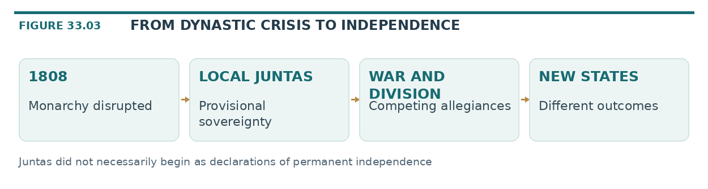

In 1808 Napoleon's interventions and the forced abdications at Bayonne undermined the Spanish monarchy's recognized center. Resistance to French rule in Spain produced regional <em>juntas</em>—temporary governing bodies claiming to act in the absence of the legitimate king. Colonial cities faced a dilemma: were they obliged to obey a particular peninsular junta, or could they exercise the same right to govern themselves until royal authority was restored?

Across Spanish America, local councils and political groups debated what sovereignty meant. Some places created juntas in 1809 or 1810; others rejected them, or oscillated between loyalty and autonomy. Participation was often concentrated among urban elites, but wars and local political bargaining broadened the actors involved. A junta was not necessarily a declaration of permanent independence. It could be a claim to rule in the king's name while refusing the authority of another regional government.

<figure class="figure" id="figure-33-3">

<figcaption>Figure 33.3. Juntas did not necessarily begin as declarations of permanent independence. <a class="figure-anchor" href="#figure-33-3" aria-label="Link to this figure">#</a></figcaption>
</figure>

The distinction is fundamental. <em>Autonomy</em> means making decisions locally within or alongside a broader political order; <em>independence</em> means asserting sovereignty separate from that order. Political movements may travel from the first to the second when circumstances change. Treating every junta as a nationalist state from birth imposes later national narratives on a much more uncertain historical moment.
