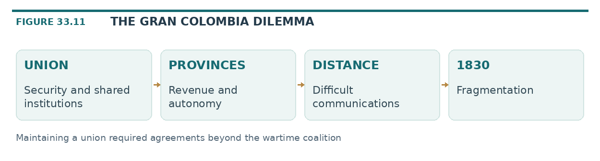

The union associated with Bolívar was ambitious, but the political geography of northern South America presented major barriers. Caracas, Bogotá, Quito, and other centers possessed different commercial connections and governing traditions. Mountains and long distances made communication slow. Provincial elites feared that a strong central administration might redirect resources and appointments away from them. Military commanders with wartime prestige could challenge civilian institutions or demand regional autonomy.

By 1830 Gran Colombia was dissolving into separate political entities; Venezuela and Ecuador emerged as distinct states, while the remaining republic became the predecessor of modern Colombia and later Panama's history followed a different course. The process cannot be explained by only one man's disappointment. Constitutional conflict, fiscal interests, local identity, and the personal power of commanders reinforced one another.

<figure class="figure" id="figure-33-11">

<figcaption>Figure 33.11. Maintaining a union required agreements beyond the wartime coalition. <a class="figure-anchor" href="#figure-33-11" aria-label="Link to this figure">#</a></figcaption>
</figure>

Nor does fragmentation prove that Latin America lacked the cultural capacity for unity. The region included multiple legitimate projects of political membership and real conflicts over who should tax, judge, recruit, and legislate. A federation or union survives only when its components believe the shared benefits outweigh the costs of surrendering some decision-making power. That calculation changes as wars end and emergency coalitions lose their common enemy.
