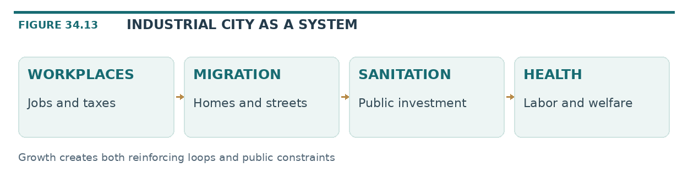

Consider the needs of a growing industrial town. Factories need fuel, workers, water and roads. Workers need food, housing and transport. Households generate waste; streets require drainage; commerce needs docks and warehouses; employers need credit and insurance; families seek schools and places of worship. None of these components functions entirely alone. Failure in one can weaken the others: flooding interrupts roads, cholera reduces labor supply, and inadequate water limits population density.

This is a practical example of systems thinking from Chapter 7. We can draw reinforcing loops—more firms attract more workers, whose spending attracts more shops and services—and balancing constraints—crowding raises rents, pollution harms health, and expensive transport limits expansion. Local governments faced choices about taxation, debt, public contracts and who benefited from improvement. Private providers sometimes delivered essential services, but their incentives did not always align with universal access.

<figure class="figure" id="figure-34-13">

<figcaption>Figure 34.13. Growth creates both reinforcing loops and public constraints. <a class="figure-anchor" href="#figure-34-13" aria-label="Link to this figure">#</a></figcaption>
</figure>

The industrial city therefore changed the possibilities and limits of political power. Urban councils and national governments could use planning, sanitation and labor rules to reduce collective risks. They could also privilege property owners, displace poorer residents or make workers more visible to policing. Urban infrastructure was a contested distribution of costs and benefits, not merely a neutral set of pipes and roads.
