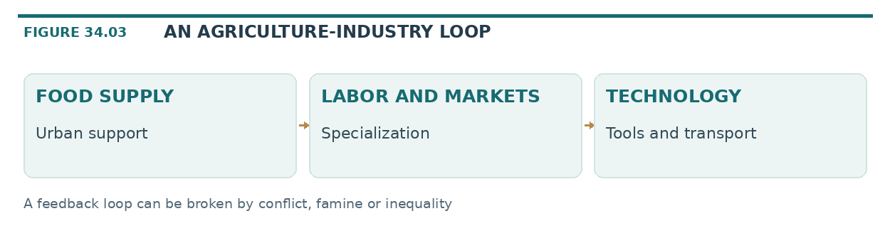

Agricultural change and industrialization influenced one another. Better drainage, selective breeding, changes in crop rotations and land use, improved transport and new commercial relationships could support larger urban populations by producing and distributing food more effectively. But no single 'agricultural revolution' happened everywhere on one date. Enclosure—the consolidation or privatization of certain shared and open-field rights—could benefit some farmers and landlords while reducing access to resources for others. Its timing, regional extent and relationship with migration remain subjects of research.

Population growth expanded potential markets for clothing, household items and fuel. It could also increase the pool of workers seeking wages. Rising demand did not automatically generate factories: consumers still needed purchasing power, merchants needed routes, and producers needed workable technologies. Manufacturing, farming and trade created feedback loops. Towns demanded grain and dairy products; rural districts bought iron tools and cloth; railways eventually reduced the cost of moving both.

<figure class="figure" id="figure-34-3">

<figcaption>Figure 34.3. A feedback loop can be broken by conflict, famine or inequality. <a class="figure-anchor" href="#figure-34-3" aria-label="Link to this figure">#</a></figcaption>
</figure>

A simple diagram illustrates the mechanism, not a universal causal sequence. More reliable food supplies can support urban concentration. Urban concentration can deepen labor specialization. Specialization can expand markets for new machinery and transport. Those technologies can in turn improve agriculture. But any link can fail under bad harvests, epidemics, war, inequality or political barriers. Industrialization was a changing system, not a straight arrow from land reform to factories.
