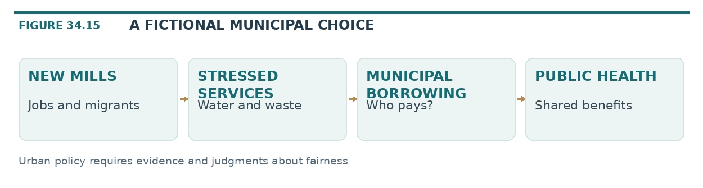

Imagine a fictional industrial town with 40,000 residents. Two new mills plan to employ 1,000 workers, attracting perhaps 3,000 additional residents when households and service workers are included. Local landlords welcome demand for rooms; shopkeepers anticipate sales; factories want reliable water. But the town's wells and drainage already struggle, and the river receives waste from homes and workshops. The council must decide whether to borrow for a waterworks and sewer project. These figures are hypothetical and not derived from a particular historical municipality.

The apparent problem is financial, but the deeper issue is distribution. The owners of large properties may prefer low taxes if their houses already have private water. Tenants may benefit most from improvements but possess little political voice. Businesses want enough healthy workers to operate reliably. A loan creates an immediate public liability, while reduced illness and higher land values may appear later. Who gets to vote, who pays rates, and who controls contracts matter as much as the engineering design.

<figure class="figure" id="figure-34-15">

<figcaption>Figure 34.15. Urban policy requires evidence and judgments about fairness. <a class="figure-anchor" href="#figure-34-15" aria-label="Link to this figure">#</a></figcaption>
</figure>

A thoughtful decision requires several kinds of evidence: the costs of pipes and maintenance, rates of waterborne illness, demographic forecasts, land ownership, tax capacity and alternatives. It also requires judgments about fairness and public obligation. This case brings together economics, history, urban planning and political philosophy. The Industrial Revolution created not only factories but recurring dilemmas about collective investment in a shared future.
