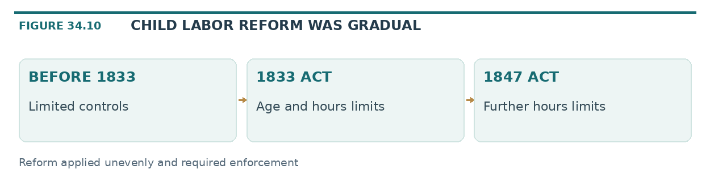

Children worked in agriculture, household trades, domestic service and workshops long before mechanized factories. Industrialization changed the location, scale, supervision and hazards of some forms of child labor. Children might attend machines, move materials, work underground or assist family businesses. Some parents depended on their wages for rent and food. Poverty and restricted educational options were important causes, while employers gained from cheap and often pliable labor. Neither family necessity nor legal custom makes dangerous work harmless.

Britain's Factory Act of 1833 restricted employment in textile factories, prohibited factory employment of children younger than nine, limited hours for older children and created an inspectorate. The 1847 Ten Hours Act further restricted work by women and young people in specified textile settings. These laws developed over time, applied to particular workplaces and were imperfectly enforced. They did not immediately end child labor across all occupations, and they should not be confused with universal compulsory schooling or comprehensive modern labor protection.

<figure class="figure" id="figure-34-10">

<figcaption>Figure 34.10. Reform applied unevenly and required enforcement. <a class="figure-anchor" href="#figure-34-10" aria-label="Link to this figure">#</a></figcaption>
</figure>

Historical comparison requires care. A photograph of children in a mine tells us something powerful about work, but its wider meaning depends on date, location, task, hours and alternatives. Factory records may undercount informal work. Parliamentary testimony can reveal abuses but was collected in settings shaped by reform campaigns and political aims. Combine personal testimony, wages, census evidence, law and enforcement records rather than allowing one dramatic image to stand for every industrial childhood.
