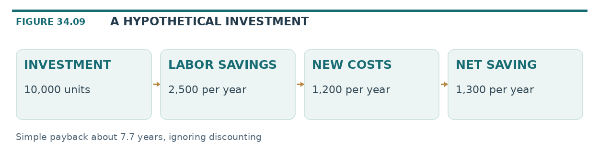

Machines cost money before they produce anything. Industrialists needed buildings, engines, raw materials, wages, maintenance reserves and commercial relationships. Some financed their businesses from family wealth or retained profits; others relied on partnerships, local lenders, banks, investors and trade credit. The development of financial institutions reduced certain barriers to expansion, while speculative bubbles and failures revealed the risks of rapid investment.

An entrepreneur's role should not be reduced to heroic invention. A successful manufacturer might never design a machine but could organize suppliers, negotiate credit, recruit skilled workers, solve bottlenecks and sell reliable products. A technically impressive invention could fail commercially if it was expensive to repair, lacked buyers, faced legal disputes or arrived before necessary infrastructure. Conversely, many profitable improvements were gradual and difficult to attribute to one famous individual.

<figure class="figure" id="figure-34-9">

<figcaption>Figure 34.9. Simple payback about 7.7 years, ignoring discounting. <a class="figure-anchor" href="#figure-34-9" aria-label="Link to this figure">#</a></figcaption>
</figure>

Consider a hypothetical textile mill investing 10,000 monetary units in equipment. If the machinery saves 2,500 units of labor costs annually but adds 1,200 units in coal, repairs and financing costs, the annual net operating saving is 1,300 units before taxes and other changes. Simple payback would exceed seven years, ignoring discounting and business risk. A different mill paying lower wages or much higher fuel prices might reject the same machinery. This numerical exercise explains why innovation and adoption are related but not identical decisions.
