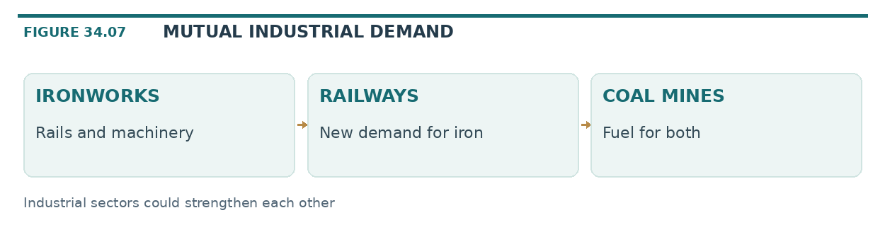

Industrial societies required more than thread and power. They needed iron for engines, tools, bridges, rails, ships and buildings. In Britain, smelting iron with coke made from coal developed well before the nineteenth century, but improvements in furnace design and fuel use gradually increased productive capacity. Henry Cort's late eighteenth-century puddling and rolling processes were important innovations among several in wrought-iron production. Later technologies, including the Bessemer process in the 1850s, made steel production a central feature of a subsequent phase of industrial development.

Iron production was a chain of mutually dependent activities. Mines provided ore and fuel; furnaces smelted; foundries cast shapes; smiths and rolling mills processed metal; transport networks connected customers. An expanding railway system generated demand for rails and locomotives, while cheap iron supported further railway building. Similar positive feedback connected coal mining, steam power and machine manufacture.

<figure class="figure" id="figure-34-7">

<figcaption>Figure 34.7. Industrial sectors could strengthen each other. <a class="figure-anchor" href="#figure-34-7" aria-label="Link to this figure">#</a></figcaption>
</figure>

The new industrial landscape also had costs. Mines exposed workers to collapses, water, dust and dangerous gases. Furnace districts generated heat, waste and air pollution. Industrial accidents were not merely a by-product of individual carelessness; they were shaped by technology, working hours, safety practices, managerial incentives and the strength of legal protections. An account that celebrates engineering should also examine who bore the risks of producing its materials.
