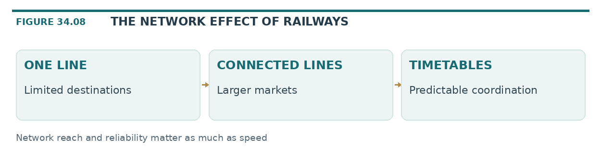

The Stockton and Darlington Railway opened in 1825 as a landmark in the commercial use of locomotives and rail transport. The Liverpool and Manchester Railway, opened in 1830, became an influential example of a line connecting major commercial centers. Early railways mixed technological experiments with investment, political controversy and public curiosity. Their eventual expansion helped make movement faster and more predictable, but tracks were expensive to lay and required bridges, tunnels, stations, workshops, skilled crews and reliable maintenance.

Railways altered the economics of time. Producers could plan deliveries against published timetables; fresh foods reached different markets; passengers could live, work and visit across greater distances. Telegraph systems later improved coordination, and railway operation contributed to pressures toward standardized time. Yet a new route could also redirect commerce away from older market towns, reduce the income of some carriers and concentrate power in companies controlling critical infrastructure.

<figure class="figure" id="figure-34-8">

<figcaption>Figure 34.8. Network reach and reliability matter as much as speed. <a class="figure-anchor" href="#figure-34-8" aria-label="Link to this figure">#</a></figcaption>
</figure>

Railways are a useful case study in network effects. One isolated line may offer limited value; many connected lines enable new patterns of travel and trade. Conversely, a railway built without enough freight, passengers or financial planning can become an expensive burden. Industrial change combined spectacular engineering with ordinary problems of investment, debt, regulation and monopoly.
