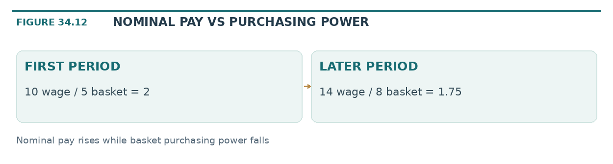

Suppose a hypothetical worker earned 10 units per week in 1800 and 14 units in 1830. A quick description calls this a 40 percent pay rise. But if a basket of essentials cost 5 units at the first date and 8 at the second, the worker's wage buys two baskets initially and only 1.75 baskets later. Real purchasing power has fallen despite a higher nominal wage. This is an illustrative calculation, not a reconstruction of historical Britain.

Even a correct real-wage index leaves unanswered questions. Does the basket reflect what poor households actually consumed? Did goods improve in quality? Did women and children earn additional income? Did people move between towns or occupations? How many days and hours did they work? Did unemployment rise? Did rents, disease, access to clean water or urban crowding change? A wage series can illuminate economic opportunity without serving as a complete measure of lived welfare.

<figure class="figure" id="figure-34-12">

<figcaption>Figure 34.12. Nominal pay rises while basket purchasing power falls. <a class="figure-anchor" href="#figure-34-12" aria-label="Link to this figure">#</a></figcaption>
</figure>

Historical estimates often depend on accounts from employers, urban institutions, household budgets, parish records and later reconstructions. The surviving information is uneven, especially for informal work, women's earnings and communities outside major commercial centers. A responsible history explains not only the number reported but also the group it describes, the index or assumptions used, and how alternative measures might alter the interpretation. This method will reappear in our later chapters on economics and statistics.
