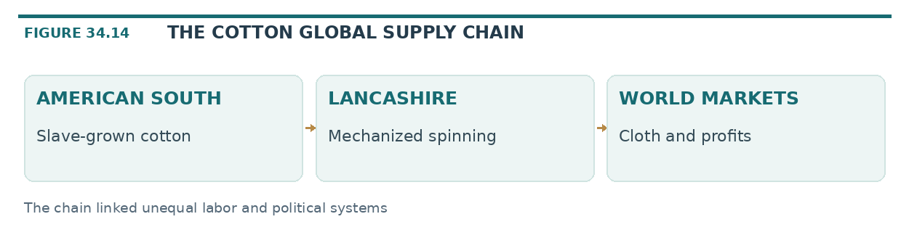

Industrializing Europe was part of a global economy shaped by conquest, enslavement, unequal trade and political power. Cotton mills in Lancashire drew heavily on raw cotton cultivated by enslaved labor in the American South. Manufacturers sold products to markets within and outside Europe's empires; merchants and financial institutions linked industrial centers to ports and plantations. These connections make it impossible to understand the factory only by looking at the factory gates.

Debates continue over how much profits from slavery and empire contributed to the total financing of British industrialization. The conclusion that colonial commerce mattered is not the same as asserting that plantation profits alone caused the Industrial Revolution. Scholars investigate capital accumulation, raw-material supplies, state power, demand and industrial technology separately and together. Earlier chapters on Atlantic slavery and maritime expansion provide the necessary context for interpreting these arguments.

<figure class="figure" id="figure-34-14">

<figcaption>Figure 34.14. The chain linked unequal labor and political systems. <a class="figure-anchor" href="#figure-34-14" aria-label="Link to this figure">#</a></figcaption>
</figure>

Industrialization also affected regions that already had highly developed craft economies. Mechanized European textiles competed with Indian producers, while colonial tariffs, fiscal institutions and market access altered commercial conditions. The timing and scale of Indian textile deindustrialization are debated, and textile exports were not the whole of India's manufacturing economy. The essential point is that changing international prices and unequal political power could transfer opportunities and costs across continents, even when inventions originated far away.
