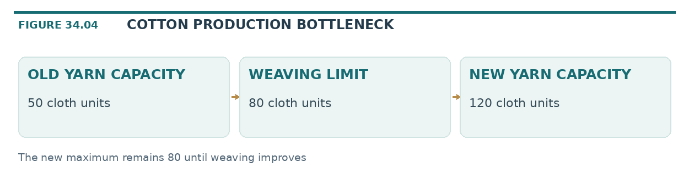

The spinning jenny, associated with James Hargreaves in the 1760s, allowed one operator to spin multiple spindles. Richard Arkwright's water frame used powered rollers to draw and twist fibers, helping create stronger yarn. Samuel Crompton's spinning mule combined features of earlier systems and contributed to finer and more flexible yarn production. These devices were improved repeatedly by other mechanics and workers. Invention dates are milestones in ongoing development, not moments when a finished technology instantly conquered the market.

Spinning machinery altered the economics of textile production. A household spinner working with a single wheel faced different limits from a mill operating many spindles with water power. Yet mechanization did not simply remove labor. It changed the tasks workers performed: tending machinery, preparing materials, repairing equipment and transporting products. Some occupations shrank, new occupations arose, and the distribution of wages and bargaining power shifted.

<figure class="figure" id="figure-34-4">

<figcaption>Figure 34.4. The new maximum remains 80 until weaving improves. <a class="figure-anchor" href="#figure-34-4" aria-label="Link to this figure">#</a></figcaption>
</figure>

Think of a hypothetical textile process making yarn and weaving cloth. Initially, yarn production supports 50 units of cloth per day while handlooms could make 80. Faster spindles raise yarn capacity to 120 units, but the maximum cloth output becomes 80 until weaving improves. No amount of spinning investment alone can overcome the new bottleneck. This example is invented for teaching; it demonstrates why historical economists study connected production systems rather than counting patented inventions.
