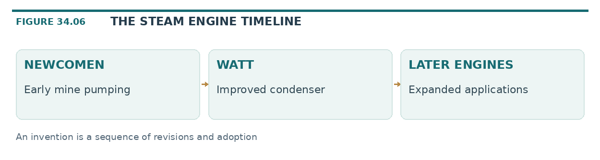

Thomas Newcomen's early atmospheric engines, developed in the early eighteenth century, were especially useful for pumping water from mines. James Watt's work on a separate condenser, patented in 1769, reduced a major source of wasted heat and improved engine efficiency. The commercial partnership of Watt and Matthew Boulton helped manufacture and deploy improved designs. Other engineers produced their own innovations, and high-pressure engines later broadened the uses of steam power. It would be inaccurate to say Watt invented the first steam engine or that his model instantly replaced all earlier systems.

Steam engines had to be made from accurately shaped cylinders, valves and other components. This created demand for better machine tools, metalworking and engineering standards. Steam power also needed fuel, water, skilled operators and regular repair. The wider significance of an invention lies not only in its conceptual breakthrough but also in whether entire production and maintenance systems can support it.

<figure class="figure" id="figure-34-6">

<figcaption>Figure 34.6. An invention is a sequence of revisions and adoption. <a class="figure-anchor" href="#figure-34-6" aria-label="Link to this figure">#</a></figcaption>
</figure>

Consider two factories making similar goods. One sits beside a reliable river, while the other has easy access to coal and railway routes but unreliable water flow. A steam engine might be economical in the second location before the first. Technology thus interacts with geography, prices and existing investments. Historians study diffusion—the spread of a technique across places and industries—because a machine's economic effects depend on how widely, effectively and affordably it is used.
