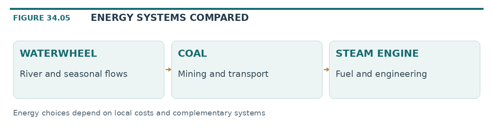

Early industrial factories did not immediately depend on steam. Many mills were built near fast-flowing rivers because waterwheels provided power. Their location was constrained by seasonal flow, geography and ownership of water rights. Steam technology gradually expanded the range of possible industrial locations, but adoption depended on fuel prices, efficiency and local conditions. Where coal was expensive, waterpower could remain competitive for a long time.

Coal had already been burned for heating and other purposes before the Industrial Revolution. Its growing importance came from interaction with mining, metalworking, steam engines and transport. Coal deposits promised concentrated energy; they also required miners, capital, drainage and roads or canals. More mining could create demand for pumps, which could make deeper mining possible. The system generated its own technological opportunities and safety hazards.

<figure class="figure" id="figure-34-5">

<figcaption>Figure 34.5. Energy choices depend on local costs and complementary systems. <a class="figure-anchor" href="#figure-34-5" aria-label="Link to this figure">#</a></figcaption>
</figure>

Fossil fuels changed the long-run energy ceiling. A society relying heavily on wood and animal power draws energy through land, biomass and daily feed. Coal stores energy accumulated over geological time; burning it allows one locality to use power that would otherwise require vast areas of forest or grazing. The transition did not eliminate dependence on land, crops or labor. It enabled a new and eventually very large flow of energy while introducing smoke, mine damage and atmospheric carbon emissions whose consequences are felt far beyond the original industrial districts.
