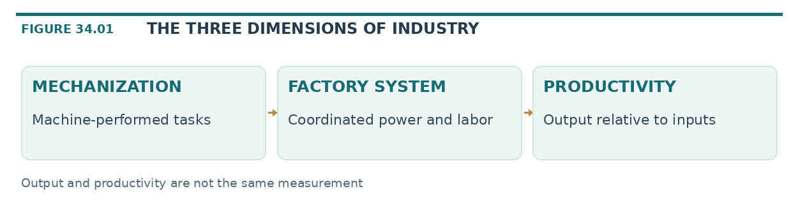

Industrialization is more than the appearance of a steam engine or a factory. It involves a sustained shift toward manufacturing and other activities that use greater amounts of machinery, specialized labor, organized energy and capital. It can change how a product is made, where its workers live, how production is financed, and how output is distributed. A country may have a large industrial sector without every household becoming prosperous; conversely, some places can increase productivity through agriculture, services or small-scale manufacturing without immediately reproducing the British factory model.

Historians distinguish <em>mechanization</em>—using machines to perform tasks previously done by people or animals—from <em>factory organization</em>, which concentrates people and equipment within a coordinated workplace. They also separate industrial output from <em>productivity</em>. If a workshop makes twice as much cloth only because it hires twice as many workers for the same hours, output rises but output per worker may not. If machines and better organization double cloth production with the same labor inputs, labor productivity rises. A careful account also asks how much coal, cotton, water, capital and land were required to secure that gain.

<figure class="figure" id="figure-34-1">

<figcaption>Figure 34.1. Output and productivity are not the same measurement. <a class="figure-anchor" href="#figure-34-1" aria-label="Link to this figure">#</a></figcaption>
</figure>

The earliest celebrated transformations occurred in particular branches of British textiles, ironmaking and energy. The rest of the economy was transformed at different speeds. After 1850 industrial change accelerated in regions of continental Europe and North America; later industrializers drew on different resource endowments, labor systems and state policies. There was no single staircase on which all societies stood at a different rung.
