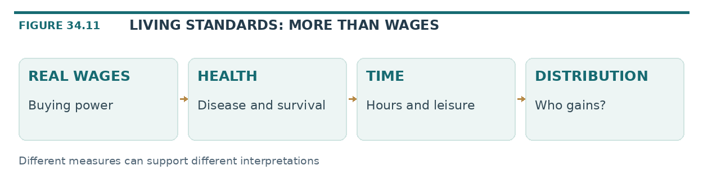

Historians have debated this question for generations because different measurements point in different directions. Industrial output and national income expanded over the long run. Yet real wages—wages adjusted for the prices of goods—did not necessarily rise quickly for ordinary workers during the earliest decades. Some benefited from cheaper manufactured cloth and new employment while suffering longer hours or worse housing. Others experienced direct losses when mechanization undermined their trades. Average national growth and the well-being of a particular worker are different claims.

The debate between 'optimist' and 'pessimist' interpretations has evolved as researchers compare wages, food consumption, stature, child mortality, working time, inequality, living conditions and life expectancy. Such measures cannot be mechanically combined without discussing values and data quality. A person whose wage rises but working day grows longer may have more purchasing power and less leisure. A city offering many jobs may expose children to higher mortality. Measurements can also reflect different subgroups and regions rather than a single national experience.

<figure class="figure" id="figure-34-11">

<figcaption>Figure 34.11. Different measures can support different interpretations. <a class="figure-anchor" href="#figure-34-11" aria-label="Link to this figure">#</a></figcaption>
</figure>

One important interpretation is sometimes called <em>Engels' pause</em>: during a period of rising productive capacity, much of the gain initially accrued to capital owners and other groups before typical wages rose more substantially. This is a hypothesis about the distribution and timing of gains, not a claim that every worker became poorer. The long-term improvements in wealth and health associated with industrial development are real, but their distribution depended on institutions, public health, education, labor organization and subsequent technologies.
