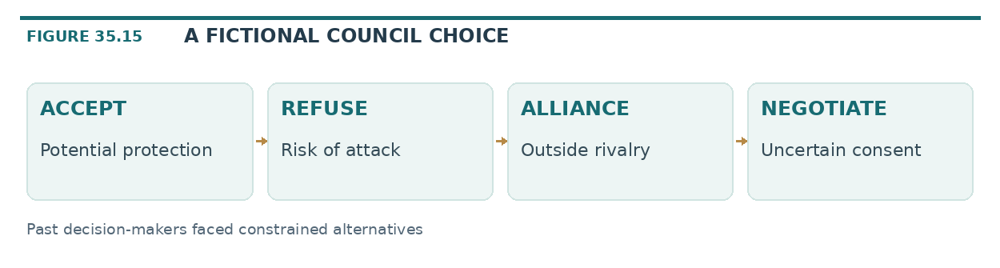

Consider a fictional African political council in the 1890s. An imperial agent requests a treaty promising exclusive trading rights and 'protection' from enemies. The agent has a small armed escort but represents a power with overseas military resources. Some council members believe an agreement could secure trade and weapons. Others fear that the language will enable foreign officials to tax the community and replace its institutions. A neighboring polity has already signed a treaty and might use the new alliance against this community. The scenario is invented to illuminate choices, not to portray any specific ruler.

Analyze four options: accept the treaty, refuse it, seek a competing foreign partner, or negotiate limited commercial rights without sovereignty transfer. Each has uncertain costs. Refusal might preserve formal independence yet provoke attack; acceptance might reduce an immediate threat but strengthen future intrusion; a rival alliance might intensify outside competition; restricted terms might be ignored or mistranslated. None guarantees safety. The council also has internal inequalities: merchants, farmers, religious leaders and pastoral communities may face different consequences.

<figure class="figure" id="figure-35-15">

<figcaption>Figure 35.15. Past decision-makers faced constrained alternatives. <a class="figure-anchor" href="#figure-35-15" aria-label="Link to this figure">#</a></figcaption>
</figure>

The exercise explains why retrospective moral judgments should not replace historical analysis. We can clearly condemn conquest while recognizing that people under threat faced difficult decisions with incomplete information. The task is to reconstruct their alternatives and institutions, not imagine that one obvious choice would have prevented every disaster.
