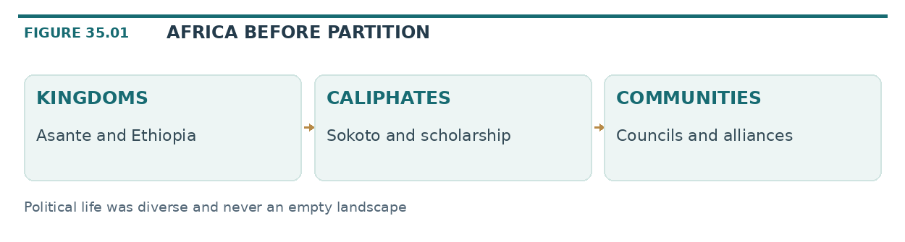

Around 1880 Africa contained a striking variety of political and social arrangements. In West Africa, Asante remained an important military and commercial kingdom, the Sokoto Caliphate governed large territories, and communities along the Niger and coast navigated old trading and religious networks. In the interior, the Luba and Lunda traditions, the Yeke kingdom, and many other polities shaped central African politics. Along the east coast, merchants and religious leaders connected African communities to Indian Ocean economies. In the south, Nguni-speaking kingdoms, settler states, African chiefdoms and trading communities interacted through warfare and diplomacy.

Political authority was not everywhere arranged as a territorially bounded centralized state. Some communities governed through councils, age grades, descent groups, towns or flexible alliances. Others possessed elaborate bureaucracies and armies. The absence of a European-style capital or fixed surveyed border did not mean an absence of law or sovereignty. Land might be cultivated individually but controlled through collective claims; grazing rights might depend on seasonal agreements; membership in a political community might depend more on personal allegiance than a precise line on a map.

<figure class="figure" id="figure-35-1">

<figcaption>Figure 35.1. Political life was diverse and never an empty landscape. <a class="figure-anchor" href="#figure-35-1" aria-label="Link to this figure">#</a></figcaption>
</figure>

European accounts sometimes described territory as empty, politically disorganized or waiting to be developed. Such language could convert unfamiliar institutions into a supposed justification for conquest. The first methodological task is therefore to reconstruct African societies from African oral histories, archaeology, material culture, local documents, Islamic scholarship, and critical reading of European accounts. Later colonial archives may be rich in information while reflecting the priorities of the officials who produced them. \[<a href="/035-imperialism-and-african-partition/sources/#source-1" class="cite">1</a>\]\[<a href="/035-imperialism-and-african-partition/sources/#source-2" class="cite">2</a>\]
