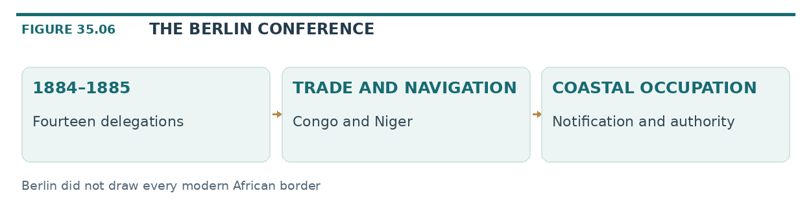

At Berlin, Chancellor Otto von Bismarck hosted diplomats from fourteen states between November 1884 and February 1885. No African rulers were represented. The General Act discussed freedom of trade in portions of central Africa, navigation on the Congo and Niger, the suppression of the slave trade, and the conditions under which new occupation of African coasts would be recognized by other powers. Articles 34 and 35 are particularly associated with notification and effective occupation for certain new coastal claims. \[<a href="/035-imperialism-and-african-partition/sources/#source-7" class="cite">7</a>\]

The conference did <strong>not</strong> assemble a complete atlas and assign every region of Africa to a colonial owner. Many boundaries were negotiated afterward through separate treaties, surveyed in stages, or imposed by war. Some had histories that preceded 1884; others were not finalized for decades. Diplomatic declarations often exceeded administrative capabilities on the ground. To say the conference helped organize European partition is correct; to say it drew every modern African border at one sitting is inaccurate.

<figure class="figure" id="figure-35-6">

<figcaption>Figure 35.6. Berlin did not draw every modern African border. <a class="figure-anchor" href="#figure-35-6" aria-label="Link to this figure">#</a></figcaption>
</figure>

Its deeper importance lay partly in what was missing: African consent and political equality. European powers debated which of them could claim authority, not whether independent communities wished to surrender it. Clauses calling for welfare or the ending of slavery did not remove the fundamentally coercive character of dispossession. The conference provided rules for imperial competition while normalizing the premise that outsiders could negotiate African sovereignty among themselves. \[<a href="/035-imperialism-and-african-partition/sources/#source-7" class="cite">7</a>\]\[<a href="/035-imperialism-and-african-partition/sources/#source-8" class="cite">8</a>\]
