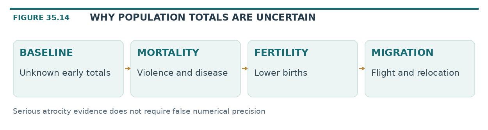

Public descriptions of Leopold II's Congo frequently repeat a very large death toll, sometimes using a round number without showing the method behind it. The scale of violence is not in serious doubt; massacres, hostage-taking, forced labor, flight, famine, disrupted fertility and disease are supported by multiple types of evidence. But reconstructing a total demographic loss requires estimating preconquest and later population levels across a vast region where comprehensive censuses were absent. Different baseline assumptions can produce sharply different results.

A responsible historical estimate distinguishes deaths directly caused by violence from broader demographic decline, while recognizing that they were connected. Population can fall because mortality rises, birth rates fall and people migrate. A report of fewer residents in one area may reflect displacement as well as death. Treating all these mechanisms as interchangeable is not careful arithmetic. On the other hand, pointing to uncertainty is not a defense of the regime. We do not need an exact numerical total to recognize a system of grave abuses.

<figure class="figure" id="figure-35-14">

<figcaption>Figure 35.14. Serious atrocity evidence does not require false numerical precision. <a class="figure-anchor" href="#figure-35-14" aria-label="Link to this figure">#</a></figcaption>
</figure>

The case makes a general lesson concrete: when a historical crime is established, debate over its numerical scale should refine our understanding rather than turn into an excuse to deny it. Historians should explain what each estimate counts, what evidence supports it, and what remains unknown. Sources such as Congo reform reports need scrutiny, but so do apologetic accounts from colonial authorities. \[<a href="/035-imperialism-and-african-partition/sources/#source-5" class="cite">5</a>\]\[<a href="/035-imperialism-and-african-partition/sources/#source-16" class="cite">16</a>\]
