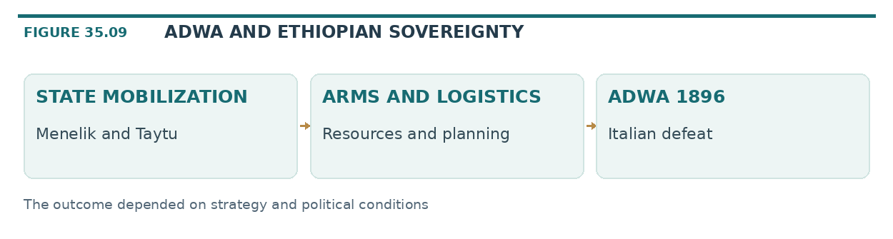

The Ethiopian Empire was one of the most significant exceptions to European conquest during the Scramble. Emperor Menelik II used diplomacy, expansion within the region, military modernization and arms purchases to strengthen his state. Ethiopia's internal diversity and its own imperial conquests must be acknowledged alongside its successful defense against European imperialism. In 1889 the Treaty of Wuchale (Uccialli) became the subject of divergent Italian and Ethiopian interpretations over whether Ethiopia had accepted Italian control of foreign relations.

When Italy attempted to enforce its claim, Menelik mobilized a large force supported by military leaders and communities across his empire, including Empress Taytu Betul. The Ethiopian victory at Adwa on 1 March 1896 destroyed Italy's immediate project of conquest and secured international recognition of Ethiopian independence. It was a victory of organized supply, leadership, effective weaponry, political mobilization and strategy—not evidence that one army possessed magical immunity to European military technology. \[<a href="/035-imperialism-and-african-partition/sources/#source-11" class="cite">11</a>\]

<figure class="figure" id="figure-35-9">

<figcaption>Figure 35.9. The outcome depended on strategy and political conditions. <a class="figure-anchor" href="#figure-35-9" aria-label="Link to this figure">#</a></figcaption>
</figure>

The battle became a powerful symbol for later African and diasporic political movements. It also offers a comparative question: why could Ethiopia resist where other states lost sovereignty? Factors included geography, centralized mobilization, diplomatic opportunities, available weapons, leadership and the limits of Italian planning. No simple ranking of cultural merit or courage explains the difference. Ethiopia's victory reveals that outcomes depended on specific political and material circumstances.
