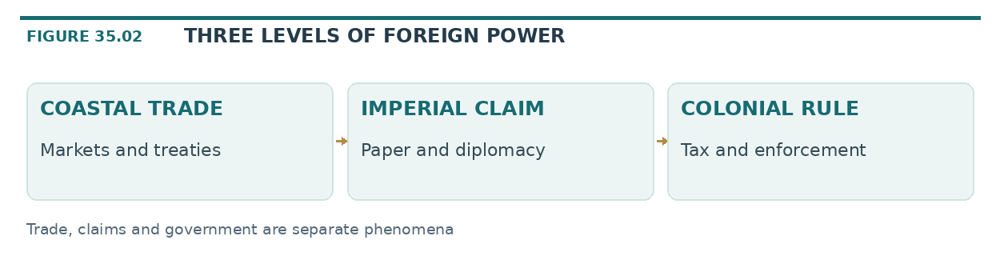

Europeans had traded at African coasts for centuries without routinely commanding vast continental territories. Portuguese and other merchants purchased gold, ivory and captives; commercial activity often depended on African authorities who controlled routes, taxes, diplomacy and access to inland markets. During the nineteenth century, the suppression of the transatlantic slave trade occurred unevenly, and commerce in palm oil, groundnuts, cloves, timber and other products expanded. These shifts did not automatically produce European governments over African populations.

Territorial empire involved new demands: replacing or subordinating rulers, administering taxes, establishing courts, protecting concessions, recruiting or compelling labor, and claiming exclusive jurisdiction. Merchants could support the process when they wanted predictable tariffs or secure contracts, but many did not need annexation to earn profits. Missionaries might criticize abuses and provide education while also supporting claims about European moral superiority. Explorers, surveyors and chartered companies helped create geographic intelligence; some became political lobbyists for conquest.

<figure class="figure" id="figure-35-2">

<figcaption>Figure 35.2. Trade, claims and government are separate phenomena. <a class="figure-anchor" href="#figure-35-2" aria-label="Link to this figure">#</a></figcaption>
</figure>

A coastal flag, a signed commercial treaty and effective governance were distinct things. Some imperial governments made ambitious map claims with few officials in the interior. Elsewhere, especially settler districts and strategic ports, political control was far more intrusive. The chronology of imperialism makes little sense unless we separate <strong>economic influence, diplomatic claim, coercive occupation and routine administration</strong>.
