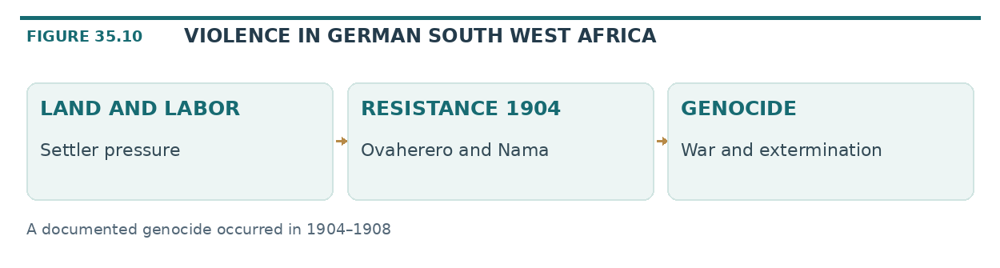

In German South West Africa—present-day Namibia—settler land demands, cattle losses, debt, racial discrimination and coercive labor policies created severe pressures. In 1904 Ovaherero people rose against colonial rule. German military retaliation escalated into a campaign of extermination, including attacks on civilians, the driving of people into waterless regions, detention and forced labor. Nama communities also resisted, and German repression extended through 1908. The events are widely recognized by historians as genocide. Germany has publicly acknowledged its historical and moral responsibility, although the political and legal questions around restitution remain contested. \[<a href="/035-imperialism-and-african-partition/sources/#source-12" class="cite">12</a>\]

The genocide was not an unfortunate side effect of ordinary administration. It was a targeted program of destruction linked to colonial power, racism, military decisions and dispossession. Figures for deaths differ by source and method; the absence of a single uncontested number must not be used to obscure the vast loss of life. Victim testimony, military orders, survivor memory, mission records and later investigations reveal how state violence and the destruction of livelihoods reinforced one another.

<figure class="figure" id="figure-35-10">

<figcaption>Figure 35.10. A documented genocide occurred in 1904–1908. <a class="figure-anchor" href="#figure-35-10" aria-label="Link to this figure">#</a></figcaption>
</figure>

The case also forces a difficult comparison. Settler colonies could make land and labor central political objectives, creating specific incentives for displacement. But violent coercion was not confined to settler regimes; plantation and concession systems elsewhere produced extreme abuse without large European settler populations. Comparing colonial forms helps identify mechanisms rather than treating every empire as an identical institution.
